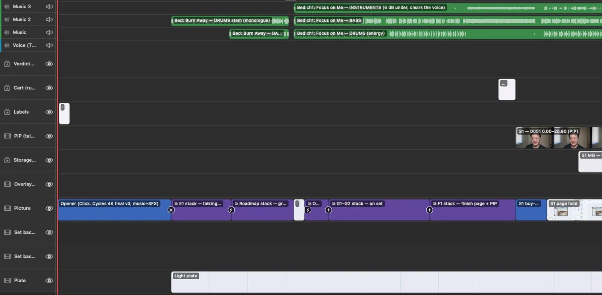

<p align="center"></p>

# HTCUT

**The video editor your AI can drive.** You edit in the app. Claude Code edits the same project from the terminal, at
the same time. Every change is an undoable step in one shared history, so neither of you overwrites the other.

Free for Apple Silicon Macs (macOS 15 or later). No account.

**[Download HTCUT](https://github.com/hanley-tech/htcut/releases/latest/download/HTCUT.dmg)** ·
[Website & tutorials](https://htcut.hanley.world) · [Report a bug](https://github.com/hanley-tech/htcut/issues/new/choose) ·
[Discussions](https://github.com/hanley-tech/htcut/discussions)



## What this repo is

The public home of HTCUT: releases, bug reports, feature requests, discussions and the Claude Code plugin. HTCUT
itself is closed source; its code isn't here.

## Use it with Claude Code

1. Download HTCUT, open it once and choose **HTCUT ▸ Set Up Claude Code…** — that installs the `htcut` command and
   the skill Claude uses. Or install the plugin yourself:

   ```
   /plugin marketplace add hanley-tech/htcut
   /plugin install htcut@htcut
   ```

   (The plugin needs the `htcut` command too: **HTCUT ▸ Install Command Line Tool…**.)
2. Open a project in HTCUT, run `claude` in its folder and ask for an edit — "cut the ums and long pauses", "add
   captions", "put a lower third on the intro", "check it's ready for YouTube".
3. End a prompt with `;;` to share what you're looking at: your playhead and selected clips.

```
$ htcut read          # the timeline Claude sees
$ htcut ui            # your playhead and selection
$ htcut transcript clean --dry-run
$ htcut captions
$ htcut preflight     # loudness, cut-off text, safe areas, chapters
$ htcut export -o out.mp4
```

## What's inside

Motion graphics written as web pages (HTML, CSS, GSAP) with typed fields · editing by transcript, with filler,
silence and retake cleanup · captions · cut-outs · skin retouch · voice match, noise removal and auto-ducking · speed
ramps and smooth slow motion · picture-in-picture and device frames · Shorts from long videos with face reframing ·
a pre-publish checklist (loudness, true peak, clipped words, cut-off text, safe areas) · YouTube chapters,
description and A/B/C titles and thumbnails. Everything runs on your Mac; models download only when you first use the
feature that needs one.

<p>
</p>

## Reporting bugs

Use **Help ▸ Report a Bug…** in the app (it fills in your version and macOS), or
[open an issue](https://github.com/hanley-tech/htcut/issues/new/choose). Include what you did, what you expected and
what happened; a screen recording helps. Questions and things you made go in
[Discussions](https://github.com/hanley-tech/htcut/discussions).

## Privacy

HTCUT has no analytics or telemetry. Projects, media, transcripts and renders stay on your Mac.

© Hanley Leung · [hanley.world](https://hanley.world)
